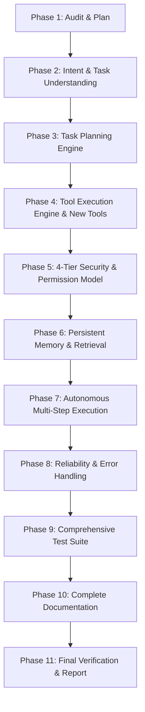

# JARVIS AI — Phase 2 Architecture & System Audit

**Audit Date**: November 22, 2026  
**Auditor**: JARVIS AI Engineering Team  
**Scope**: Full codebase audit of `D:\JARVIS_AI` prior to Phase 2 implementation  
**Baseline Test Status**: 60 passed in 0.41s  
**Runtime**: Python 3.13.5 (Windows 64-bit), `.venv` virtual environment  

---

## 1. Executive Summary

JARVIS AI currently operates as a functional foundation with an active Gemini API provider (`gemini-3.5-flash`), centralized configuration via `python-dotenv`, an initial tool registry, an AST-based safe calculator, basic workspace file operations, an initial SQLite database, and an interactive CLI.

The existing 60 unit tests pass completely. However, transitioning from a basic tool-calling bot to a resilient, production-minded **Personal AI Task Execution Agent** requires substantial enhancements in:
1. Multi-step task decomposition and dependency management.
2. Tool breadth across System Automation, Productivity, Development, and File Management.
3. Multi-tier permission enforcement with an emergency stop mechanism.
4. Long-term memory with facts, preferences, notes, and search retrieval.
5. Autonomous multi-turn task execution with user confirmation checkpoints.
6. Robustness against network delays, API rate limits, and subprocess execution hazards.

---

## 2. Existing Component Inspection

### 2.1 Agent & Conversation (`core/agent.py`, `core/conversation.py`)
- **Strengths**: Clean separation of message roles (`MessageRole.USER`, `ASSISTANT`), sliding window context limit (`MAX_CONVERSATION_HISTORY`), and session-based persistence.
- **Weaknesses**:
  - Operates strictly in single-turn tool calls: if Gemini generates tool calls, they execute and results are returned once. It cannot handle autonomous multi-turn iterative tasks (e.g., scanning a folder, analyzing file extensions, proposing an organization plan, getting approval, and moving files).
  - Lacks ambiguous intent detection and clarification prompting.
  - Lacks a global emergency stop mechanism.

### 2.2 Task Planner (`core/planner.py`)
- **Strengths**: Generates clean `TaskStep` structures with status tracking (`PENDING`, `RUNNING`, `COMPLETED`, `FAILED`, `SKIPPED`, `APPROVAL_NEEDED`).
- **Weaknesses**:
  - Planner only converts model function calls 1:1; it does not decompose higher-level natural language instructions into multi-step execution graphs.
  - No dependency tracking between steps (e.g., step 2 requiring outputs/arguments from step 1).
  - Missing statuses: `PLANNING`, `WAITING_FOR_APPROVAL`, `CANCELLED`.
  - No retry policies or failure recovery strategies.

### 2.3 Task Executor & Tool Registry (`core/executor.py`, `tools/registry.py`)
- **Strengths**: Strict argument validation against parameter schemas, centralized exception catching, and per-step execution audit logging.
- **Weaknesses**:
  - No execution timeouts: a blocking script or slow system command could hang the entire agent.
  - No tool categories: all tools are in a flat registry.
  - Tool execution does not support output piping between steps.

### 2.4 Existing Tools (`tools/calculator.py`, `tools/datetime_tool.py`, `tools/filesystem.py`)
- **Strengths**:
  - `calculator`: Uses `ast.parse` and safe AST walker without `eval`/`exec`.
  - `filesystem`: Strict path traversal prevention using `_resolve_safe_path` restricted to `WORKSPACE_DIR`.
- **Weaknesses**:
  - File operations are limited to 6 basic functions (`list_files`, `create_folder`, `create_file`, `read_file`, `search_files`, `file_exists`).
  - Missing file operations: `rename_file`, `copy_file`, `move_file`, `delete_file` (with strict Level 3 approval).
  - Missing system automation tools (running processes, CPU/RAM stats, opening applications, opening websites).
  - Missing productivity tools (notes, reminders, task lists, summarization).
  - Missing development tools (safe Python script execution, running approved commands).

### 2.5 Security & Permission Manager (`core/permissions.py`)
- **Strengths**: Rejects unknown permissions by default, enforces approval for destructive and external actions.
- **Weaknesses**:
  - Uses 4 ad-hoc string enums (`read_only`, `safe_write`, `destructive`, `external`) rather than the standardized 4-tier model:
    - **LEVEL 0**: READ ONLY
    - **LEVEL 1**: LOW RISK
    - **LEVEL 2**: MODERATE RISK
    - **LEVEL 3**: HIGH RISK
  - Lacks directory allowlists (e.g. allowing user-approved folders like Desktop or Downloads when specifically authorized).
  - Lacks an emergency stop mechanism that halts all background and scheduled executions immediately.

### 2.6 Memory & Database (`memory/database.py`, `memory/task_history.py`, `memory/conversation_history.py`)
- **Strengths**: Parameterized queries, foreign keys enabled (`PRAGMA foreign_keys=ON`), WAL journal mode (`PRAGMA journal_mode=WAL`), schema versioning.
- **Weaknesses**:
  - Only stores raw conversations, tasks, and key-value user preferences.
  - Missing long-term memory for important user facts.
  - Missing notes and reminders tables.
  - Missing tool usage frequency metrics.
  - Missing keyword/semantic search across memory.
  - Missing memory deletion controls.

### 2.7 AI Provider Integration (`providers/gemini.py`)
- **Strengths**: Uses modern `google-genai` SDK (v3.6.1), configured with `gemini-3.5-flash`, automatic API key redaction in error messages and logs.
- **Weaknesses**:
  - Needs exponential backoff retry for transient 503 (high demand) and 429 (rate limits).
  - Needs customizable system prompt injection for rich contextual memory.

---

## 3. Review of Existing 60 Unit Tests

All 60 tests are verified working:
1. `tests/test_calculator.py` (16 tests): Arithmetic, parentheses, powers, modulo, error handling, syntax validation.
2. `tests/test_database.py` (9 tests): DB initialization, foreign keys, task creation/update, session persistence.
3. `tests/test_filesystem.py` (19 tests): Path traversal blocking, folder/file creation, reading, non-overwrite checks.
4. `tests/test_permissions.py` (5 tests): Read-only, safe-write, destructive approval, and approval granting.
5. `tests/test_registry.py` (6 tests): Tool registration, parameter validation, execution, schema export.
6. `tests/test_settings.py` (5 tests): Missing key, placeholder key, short key, valid key, invalid history limit.

**Policy**: None of these 60 tests will be deleted or broken during Phase 2. All new tests will expand coverage.

---

## 4. Phase-by-Phase Implementation Plan

### Stage 1: Security & Permissions Upgrade (Phase 5 Foundation)
- Update `tools/__init__.py` and `core/permissions.py` to support 4 tiers:
  - `LEVEL_0_READ_ONLY` (Level 0)
  - `LEVEL_1_LOW_RISK` (Level 1)
  - `LEVEL_2_MODERATE_RISK` (Level 2)
  - `LEVEL_3_HIGH_RISK` (Level 3)
- Backward compatibility aliases maintained so existing tests pass seamlessly.
- Implement global emergency stop flag in `PermissionManager`.
- Implement directory allowlist manager with path validation.

### Stage 2: Expanded Tool Architecture (Phase 4)
- Organize tools into categories:
  - **File Management**: `list_files`, `create_folder`, `create_file`, `read_file`, `search_files`, `file_exists`, `rename_file`, `copy_file`, `move_file`, `delete_file` (Level 3).
  - **System Automation**: `get_system_info`, `get_resource_usage` (CPU/RAM/Disk via `psutil`), `list_processes`, `open_application`, `open_website`.
  - **Productivity**: `calculator`, `get_datetime`, `manage_notes`, `manage_reminders`, `manage_tasks`, `summarize_text`.
  - **Development Assistance**: `create_python_file`, `read_code_file`, `explain_code_error`, `run_python_script` (restricted subprocess with timeout), `execute_approved_command` (strict whitelist).
- Tool execution timeout enforcement in `tools/registry.py`.

### Stage 3: Planning Engine & Dependency Graphs (Phase 3)
- Extend `core/planner.py`:
  - Support `PENDING`, `PLANNING`, `RUNNING`, `WAITING_FOR_APPROVAL`, `COMPLETED`, `FAILED`, `CANCELLED`.
  - Add task step dependencies (`depends_on: list[int]`).
  - Add output parameter mapping (`input_mapping: dict[str, str]`).
  - Add retry policy (`max_retries: int`, `retry_delay: float`).

### Stage 4: Enhanced Memory System (Phase 6)
- Update `memory/database.py` with Schema Version 2:
  - `important_facts` table.
  - `notes` table.
  - `reminders` table.
  - `tool_usage_metrics` table.
- Implement `memory/memory_manager.py` with:
  - Fact extraction & storage.
  - Context retrieval (fetching relevant facts to inject into system prompt).
  - Keyword search across conversations, tasks, and notes.
  - Memory deletion controls.

### Stage 5: Intelligent Task Understanding & Autonomous Execution (Phases 2 & 7)
- Upgrade `core/agent.py`:
  - Multi-turn autonomous tool execution loop (up to configurable max steps).
  - Step verification: check results of intermediate steps before proceeding.
  - Emergency stop check before every step.
  - User confirmation handling for Level 2 & 3 actions.
  - Safe recovery and work preservation on step failure.
  - Clarification prompting when required arguments or instructions are ambiguous.

### Stage 6: Reliability & Error Handling (Phase 8)
- Enhance `providers/gemini.py` with exponential backoff for transient 503/429 errors.
- Ensure all logs redact API keys and sensitive tokens.
- Add timeout handling to AI requests and subprocess execution.

### Stage 7: Comprehensive Testing (Phase 9)
- Unit tests for all new tools: file operations, system stats, notes, reminders, code runner.
- Unit tests for 4-tier permissions, allowlists, and emergency stop.
- Unit tests for planner dependency graphs and multi-step execution.
- Unit tests for memory search, fact storage, and context retrieval.
- Mock-based tests for multi-turn autonomous execution and failure recovery.

### Stage 8: Documentation & Verification (Phases 10 & 11)
- Write `ARCHITECTURE.md`, `TOOL_DOCUMENTATION.md`, `SECURITY.md`, `TESTING.md`.
- Update `README.md` and `DEVELOPMENT_PROGRESS.md`.
- Generate `PHASE_2_COMPLETION_REPORT.md`.

---

## 5. Risk Assessment & Mitigation

| Risk | Impact | Mitigation |
|---|---|---|
| Arbitrary command execution | Critical | Whitelist strictly permitted commands only; no arbitrary shell execution |
| Path traversal outside approved dirs | High | Resolve absolute paths and verify containment in allowlisted roots |
| Accidental data loss from file deletion | High | Require explicit interactive confirmation (Level 3 High Risk) |
| Long-running/hanging tool execution | Medium | Enforce strict timeouts (e.g. 10-30s) on all tool executions |
| Breaking existing 60 tests | Medium | Retain existing APIs and signatures with backward-compatible aliases |
| API key exposure | High | Comprehensive regex and substring redaction in all logging and exception handlers |
