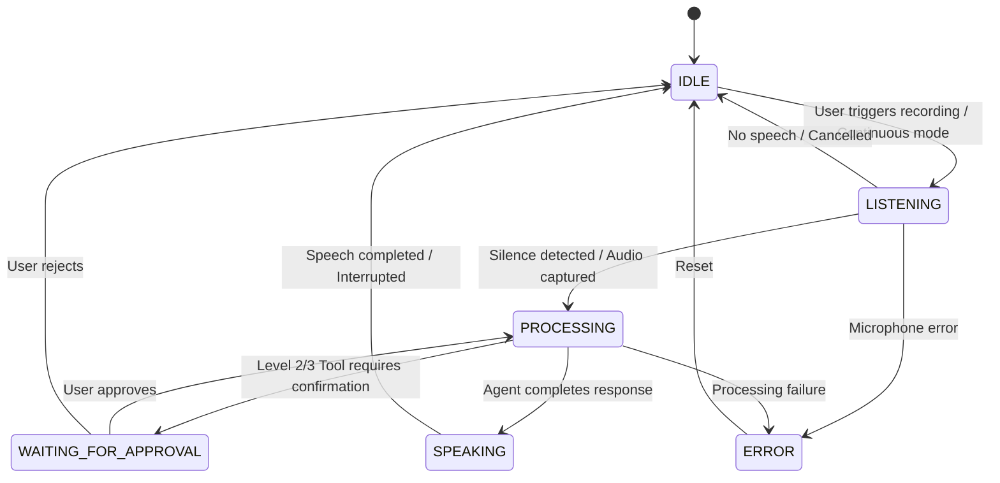

# JARVIS AI — Voice Subsystem Architecture (Phase 3)

## 1. Architectural Pipeline

```
  ┌─────────────────┐
  │   MICROPHONE    │
  └────────┬────────┘
           │ PCM Audio Stream (PyAudio / sounddevice)
           ▼
  ┌─────────────────────────────────┐
  │     SPEECH-TO-TEXT (STT)        │
  │   (voice/speech_to_text.py)     │
  │ • Ambient Noise Calibration     │
  │ • Silence / Pause Detection     │
  │ • Google STT / Faster-Whisper   │
  └────────┬────────────────────────┘
           │ Recognized Text
           ▼
  ┌─────────────────────────────────┐
  │        VOICE CONTROLLER         │
  │   (voice/voice_controller.py)   │
  │ • Voice Command Interceptor     │ ◄────── State Transitions:
  │ • State Machine Manager         │         IDLE -> LISTENING -> PROCESSING
  │ • Interrupt Event Coordinator   │         -> SPEAKING -> IDLE
  └────────┬────────────────────────┘
           │ User Instruction
           ▼
  ┌─────────────────────────────────┐
  │       JARVIS CORE AGENT         │
  │        (core/agent.py)          │
  │ • Intent & Context Augmentation │
  │ • Planner (core/planner.py)     │
  │ • 4-Tier Security & Approvals   │
  │ • Tool Executor (26 tools)      │
  └────────┬────────────────────────┘
           │ Agent Response (Text)
           ▼
  ┌─────────────────────────────────┐
  │     TEXT-TO-SPEECH (TTS)        │
  │    (voice/text_to_speech.py)    │
  │ • Markdown / Code Sanitizer     │
  │ • Sentence Chunking Buffer      │
  │ • SAPI5 pyttsx3 / edge-tts      │
  └────────┬────────────────────────┘
           │ Audio Playback
           ▼
  ┌─────────────────┐
  │    SPEAKERS     │
  └─────────────────┘
```

---

## 2. Audio State Machine

The audio state is tracked centrally via `AudioState(str, Enum)`:



- **IDLE**: Microphone is inactive, agent is standing by.
- **LISTENING**: Microphone buffer is actively streaming audio with dynamic energy calibration.
- **PROCESSING**: Audio stream has finished; transcription is being parsed and processed by the agent.
- **WAITING_FOR_APPROVAL**: Agent is paused awaiting user confirmation for a Level 2 or Level 3 operation.
- **SPEAKING**: TTS engine is streaming audio aloud through system speakers.
- **ERROR**: Hardware failure or communication exception occurred.

---

## 3. Concurrency & Interruption Architecture

1. **Non-Blocking Execution**:
   - The CLI remains responsive while audio operations execute.
   - Long TTS responses are split into sentence chunks using regex `(?<=[.!?])\s+`.
2. **Immediate Stop Signals**:
   - `VoiceController.stop_speaking()` signals `threading.Event._stop_event`.
   - The pyttsx3/audio worker immediately aborts the current speech chunk without lagging.
3. **Emergency Stop Interception**:
   - Triggering `/stop` simultaneously sets the emergency stop flag in `PermissionManager`, halts active speech via `VoiceController.stop_speaking()`, and terminates recording.
