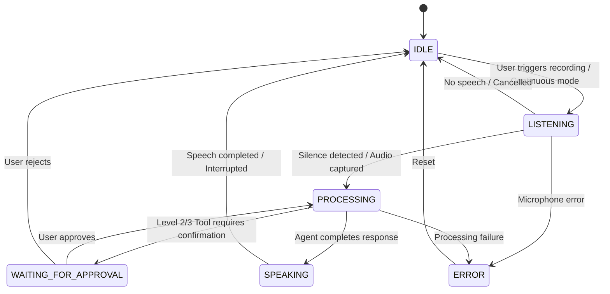

# JARVIS AI — Voice Subsystem Architecture

## 1. Architectural Pipeline

```
  ┌─────────────────┐
  │   MICROPHONE    │
  └────────┬────────┘
           │ 16 kHz Mono int16 PCM (sounddevice, single owner)
           ▼
  ┌─────────────────────────────────┐
  │    WAKE WORD & SILERO VAD       │
  │      (voice/wake_word.py)       │
  │ • openWakeWord ONNX (Hey JARVIS)│
  │ • Silero VAD v6 Endpointing     │
  └────────┬────────────────────────┘
           │ Captured Utterance (float32 in-memory)
           ▼
  ┌─────────────────────────────────┐
  │     SPEECH-TO-TEXT (STT)        │
  │   (voice/speech_to_text.py)     │
  │ • Faster-Whisper (CPU INT8)     │
  │ • English / Hindi Auto-Detect   │
  └────────┬────────────────────────┘
           │ Recognized Text
           ▼
  ┌─────────────────────────────────┐
  │  CONVERSATION & VOICE CONTROL   │
  │ (voice/conversation_manager.py, │
  │  voice/voice_controller.py)     │
  │ • Pipeline & Audio State        │
  │ • Follow-up Window (25s)        │
  └────────┬────────────────────────┘
           │ User Instruction (serialized via _agent_lock)
           ▼
  ┌─────────────────────────────────┐
  │       JARVIS CORE AGENT         │
  │        (core/agent.py)          │
  │ • Ollama + Qwen 3.5 4B          │
  │ • Planner & 4-Tier Safety Gates │
  │ • Tool Executor (26 tools)      │
  └────────┬────────────────────────┘
           │ Agent Response (Text)
           ▼
  ┌─────────────────────────────────┐
  │     TEXT-TO-SPEECH (TTS)        │
  │    (voice/text_to_speech.py)    │
  │ • Markdown / Code Sanitizer     │
  │ • Piper TTS (en_GB-alan-medium) │
  └────────┬────────────────────────┘
           │ Audio Playback (sounddevice / winsound)
           ▼
  ┌─────────────────┐
  │    SPEAKERS     │
  └─────────────────┘
```

---

## 2. Audio State Machine

The audio state is tracked centrally via `AudioState(str, Enum)`:



- **IDLE**: Microphone is inactive, agent is standing by.
- **LISTENING**: Microphone buffer is actively streaming audio with dynamic energy calibration.
- **PROCESSING**: Audio stream has finished; transcription is being parsed and processed by the agent.
- **WAITING_FOR_APPROVAL**: Agent is paused awaiting user confirmation for a Level 2 or Level 3 operation.
- **SPEAKING**: TTS engine is streaming audio aloud through system speakers.
- **ERROR**: Hardware failure or communication exception occurred.

---

## 3. Concurrency & Interruption Architecture

1. **Non-Blocking Execution**:
   - The CLI remains responsive while audio operations execute.
   - Long TTS responses are split into sentence chunks using regex `(?<=[.!?])\s+`.
2. **Immediate Stop Signals**:
   - `VoiceController.stop_speaking()` signals `threading.Event` interrupt to halt active Piper WAV playback immediately, and `/voice off` closes the `sounddevice` input stream completely.
3. **Emergency Stop Interception**:
   - Triggering `/stop` simultaneously sets the emergency stop flag in `PermissionManager`, halts active speech via `VoiceController.stop_speaking()`, and terminates recording.
